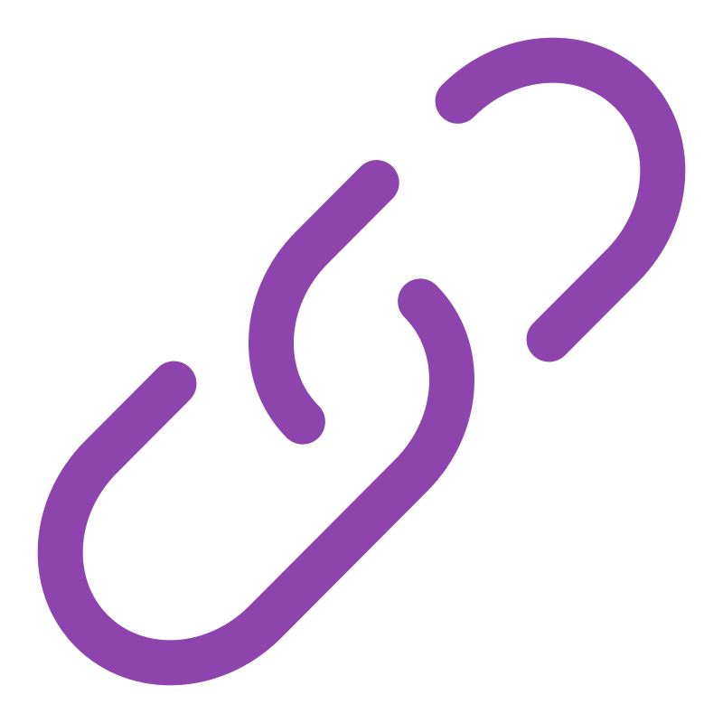

 
 

  

  

<!-- Social icons -->

  
  &#8287;&#8287;&#8287;&#8287;&#8287;
  
  &#8287;&#8287;&#8287;&#8287;&#8287;
  

 

## 👋 About me

Founding engineer at [Navys](https://navys.ai), the legal platform for private funds. I own the stack end to end, from Django and Next.js to Azure and our ISO 27001 and SOC 2 programme. I also build the AI pipeline behind Sam, our assistant, which turns inbound email into deal updates.

Before engineering, I spent two and a half years in developer support, on Meta's developer platform at Accenture and on security SaaS at Mend.

- ✔ **Full stack product work:** React, Next.js, TypeScript, Python, Go
- ✔ **AI workflows:** LLM agent pipelines on the Anthropic SDK, RAG, prompt injection defences
- ✔ **Cloud and DevOps:** Azure, AWS, Terraform, Docker, GitHub Actions
- ✔ **Security and compliance:** ISO 27001, SOC 2, Entra ID, RBAC with Casbin

🔗 **Portfolio:** [nathanrydel.dev](https://nathanrydel.dev)

## 🛠️ Core technologies

### Languages

  

### Frameworks and tools

  

<h2>📊 GitHub stats</h2>

  

<b>Note:</b> Top languages covers my public repos only. Most of my work lives in private repos.

<h3>⚡ Recent GitHub activity</h3>

<!-- https://github.com/jamesgeorge007/github-activity-readme -->
<!--START_SECTION:activity-->

1. ❗ Opened issue [#13](https://github.com/nathanrydel/go-todo-app/issues/13) in [nathanrydel/go-todo-app](https://github.com/nathanrydel/go-todo-app)
2. ❗ Opened issue [#12](https://github.com/nathanrydel/go-todo-app/issues/12) in [nathanrydel/go-todo-app](https://github.com/nathanrydel/go-todo-app)
3. ❗ Opened issue [#11](https://github.com/nathanrydel/go-todo-app/issues/11) in [nathanrydel/go-todo-app](https://github.com/nathanrydel/go-todo-app)
4. ❗ Opened issue [#10](https://github.com/nathanrydel/go-todo-app/issues/10) in [nathanrydel/go-todo-app](https://github.com/nathanrydel/go-todo-app)
5. ❗ Opened issue [#9](https://github.com/nathanrydel/go-todo-app/issues/9) in [nathanrydel/go-todo-app](https://github.com/nathanrydel/go-todo-app)
<!--END_SECTION:activity-->

  
<h4>👓 Views</h4>

  <!-- https://komarev.com/sources/github-profile-views-counter -->
  

